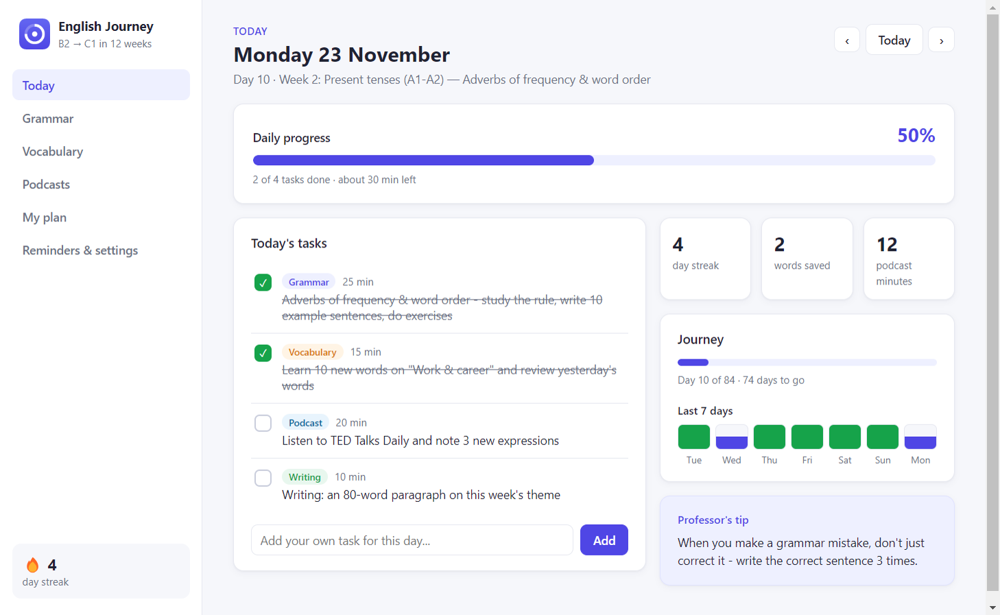

# English Journey

A simple, clean desktop app to track an English learning journey: **grammar, vocabulary, podcasts, daily tasks with a progress bar, and reminders**. It ships with a built-in 12-week plan for a B2 learner who wants to rebuild grammar from the very first lesson.



## Features

| Screen | What it does |
|---|---|
| **Today** | The plan's 4 tasks for the day (grammar, vocabulary, podcast, speaking/writing) + your own tasks. Progress bar fills as you tick tasks. Streak, journey progress, last 7 days, teacher tip. Arrows let you catch up on past days. |
| **Grammar** | 72 lessons from A1 to C1. Ticked automatically when you finish that day's grammar task. Star lessons to revise. |
| **Vocabulary** | Save words with meaning and your own example sentence. Search, filter, mark as known, and **Quiz me** flashcards. Adding 10 words in a day ticks the vocabulary task. |
| **Podcasts** | Log episodes (minutes + expressions you heard). Recommended podcasts with links. Logging an episode ticks the podcast task. |
| **My plan** | The full 12-week programme and the daily routine explained. |
| **Reminders & settings** | Daily Windows notifications at the times you choose, start with Windows, start date, export/import backup. |

Closing the window keeps the app in the **system tray** so reminders keep working. Use the tray icon → *Quit* to exit completely.

## Run it

Requirements: [Node.js](https://nodejs.org) 18+.

```powershell
npm install
npm start
```

Build a single portable `.exe` (output in `dist/`):

```powershell
npm run dist
```

## Tech

Electron + plain HTML/CSS/JavaScript. No framework, no database: data is saved locally (Electron `localStorage`) on your computer.

```
main.js          Electron window, tray, start-with-Windows
preload.js       Safe bridge between the window and Electron
src/plan.js      The 12-week study plan (edit it to change the programme)
src/app.js       All app logic (tasks, progress, words, podcasts, reminders)
src/index.html   Layout
src/styles.css   Design
scripts/make-icon.js  Generates assets/icon.png
```

See [REPORT.md](REPORT.md) for the full project report and the learning plan.

## License

MIT
