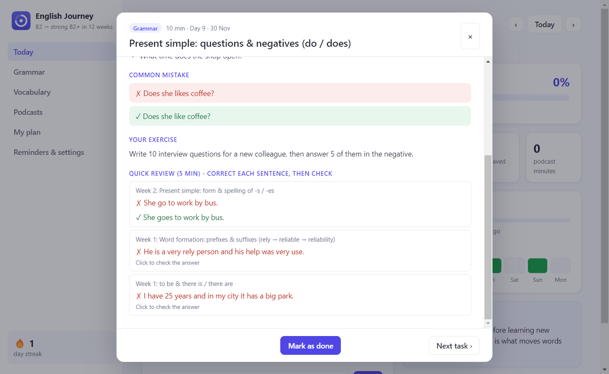
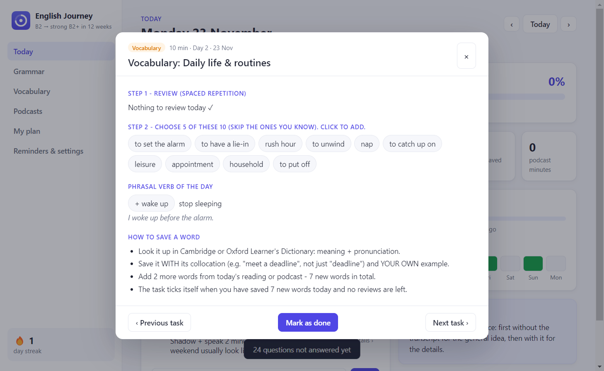
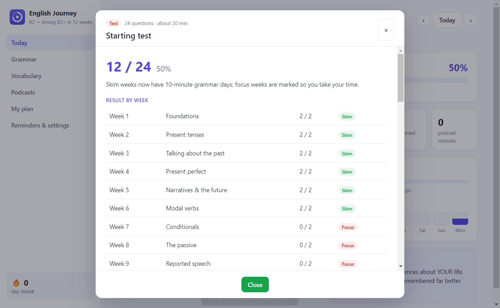
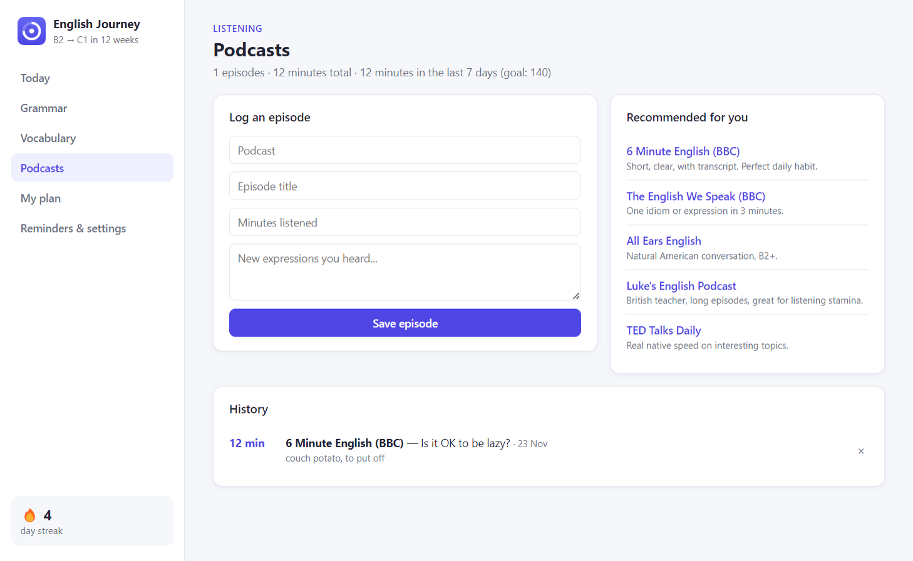
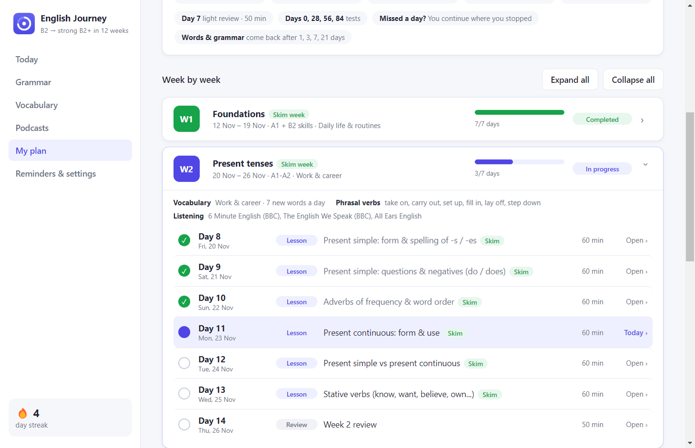
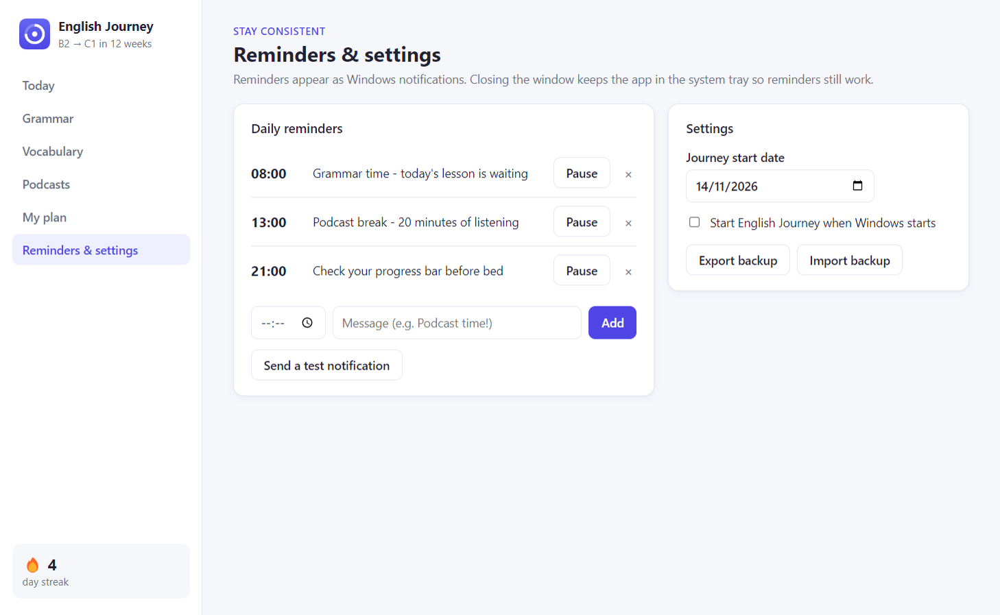

# English Journey — Project Report

**Project:** English Journey, a desktop tracker for learning English
**Author:** nour530
**Date:** 23 November 2026
**Version:** 1.1.0 (plan revised after a teacher's assessment, see section 4)

---

## 1. Introduction

Learning a language well depends less on talent than on **consistency**: doing a little every day, in a balanced way, and seeing your progress. At B2 level a learner understands most things and can communicate, but progress often stops because of small grammar gaps that became habits, and because study is irregular and unplanned.

English Journey solves this with two things in one simple desktop app:

1. **A study plan** written like a teacher's programme: a starting test, 12 weeks of grammar rebuilt from the basics, daily vocabulary with spaced repetition, reading, listening and speaking/writing, and checkpoint tests.
2. **A tracker** that turns that plan into a daily checklist with a progress bar, keeps a word bank and a podcast log, and reminds you to study.

## 2. Objectives

| # | Objective | How the app meets it |
|---|---|---|
| 1 | Revise all grammar from beginner level | 72 lessons, A1 → C1, with a starting test so known areas are skimmed |
| 2 | Grow vocabulary that lasts | 7 new words a day (with collocations) and spaced review after 1, 3, 7 and 21 days |
| 3 | Improve reading and listening | 15 min of reading + 15 min of podcast a day; podcasts get harder every 4 weeks |
| 4 | Practise speaking and writing | A daily question that uses the day's grammar, plus weekly feedback from a real person or AI |
| 5 | Measure real progress | Starting test, checkpoints in weeks 4 and 8, final test; wrong answers star lessons |
| 6 | Stay consistent | Progress bar, streak, reminders, and a plan that waits for you when you miss a day |
| 7 | Keep it simple | One window, six screens, no account, no internet needed |

## 3. The learning plan (the teacher's part)

### 3.1 Starting point, approach and honest goal

- **Level:** B2 (upper-intermediate).
- **Goal:** a **strong B2+** in 12 weeks: accurate, automatic grammar, a larger active vocabulary, and comfortable reading and listening. The plan is about **100 hours** of work. Moving from B2 to C1 is commonly estimated at around 200 guided hours, so C1 is the next step after this plan, not a promise of it.
- **Approach:** "back to basics, fast". Weeks 1–3 cover A1–A2 grammar, but the starting test turns the weeks you already master into 10-minute "skim" weeks. The plan then slows down on B1–B2 topics, where B2 learners make most of their errors, and ends with C1 structures.
- Vocabulary, reading and listening are **not** reset to beginner level: they stay at B2+.

### 3.2 Daily routine (about 75 minutes)

| Block | Time | What to do |
|---|---|---|
| Grammar | 25 min (10 on skim weeks) | The rule, examples, a common mistake, your own exercise, and a 5-minute **quick review** of the lessons from 1, 3, 7 and 21 days ago. |
| Vocabulary | 10 min | First the words **due for review**, then **7 new words**: 5 chosen from the 10-word theme list (skip what you know) + 2 from your reading or podcast. Always save the collocation. One phrasal verb of the day. |
| Reading | 15 min | One short B2 article: read for the main idea, then for words; summarise it out loud. |
| Podcast | 15 min | Listen once without the transcript, once with it. |
| Speaking / writing | 10 min | Answer the day's question using today's grammar. Once a week, get feedback from a real person or an AI tool. |

**Day 7** is a **light review day** (about 50 minutes): a 15-minute grammar review, vocabulary review, and one episode of a series in English with English subtitles.

**Test days:** day 0 (starting test), day 28 (checkpoint 1), day 56 (checkpoint 2), day 84 (final test).

### 3.3 The 12-week programme

| Week | Grammar focus | Level | Vocabulary theme |
|---|---|---|---|
| 0 | **Starting test** (24 questions, 2 per week of the plan) | – | – |
| 1 | **Foundations:** parts of speech & word order, *to be* & *there is/are*, countable/uncountable nouns, articles, **collocations**, **word formation** | A1 + B2 skills | Daily life & routines |
| 2 | **Present tenses:** present simple (form, questions, negatives), adverbs of frequency, present continuous, simple vs continuous, stative verbs | A1–A2 | Work & career |
| 3 | **The past:** past simple regular/irregular, questions & negatives, past continuous, *when/while*, *used to / would / be used to* | A2 | Travel & places |
| 4 | **Present perfect:** experiences, *just/already/yet*, *for/since*, present perfect vs past simple, present perfect continuous — **checkpoint 1 on day 28** | B1 | Technology & the internet |
| 5 | **Narratives & future:** past perfect (simple & continuous), *will* vs *going to*, present forms for future, future continuous & perfect, time clauses | B1 | Health & lifestyle |
| 6 | **Modal verbs:** ability, permission, obligation (*mustn't* vs *don't have to*), advice, deduction, past modals | B1–B2 | Education & learning |
| 7 | **Conditionals:** zero, first, second, third, mixed; *unless / provided that / in case*; *wish / if only* | B1–B2 | Money & business |
| 8 | **The passive:** all tenses, modals, *by*-agent, *It is said that…*, causative *have/get something done* — **checkpoint 2 on day 56** | B2 | Environment & nature |
| 9 | **Reported speech:** statements, questions, commands, reporting verbs, time/place changes, **indirect questions** | B2 | Media & news |
| 10 | **Clauses & verb patterns:** defining & non-defining relative clauses, gerund vs infinitive, participle clauses | B2 | Society & relationships |
| 11 | **The glue of English:** quantifiers, comparatives, prepositions, phrasal verbs, linking words, **question tags & So do I / Neither do I** | B2 | Emotions & personality |
| 12 | **Advanced polish:** inversion, cleft sentences, emphasis, advanced articles, formal vs informal register, mock test — **final test on day 84** | B2–C1 | Academic words & idioms |

Every lesson day also has a **phrasal verb of the day** (72 in total), linked to the week's theme.

### 3.4 Sources

| Skill | Sources |
|---|---|
| Grammar | *English Grammar in Use* (Raymond Murphy), British Council LearnEnglish |
| Reading | Breaking News English (levels 5–6), BBC Learning English – News Review, BBC News, The Guardian |
| Listening | Weeks 1–4: 6 Minute English, The English We Speak, All Ears English · Weeks 5–8: All Ears English, Luke's English Podcast · Weeks 9–12: Luke's English Podcast, TED Talks Daily |
| Dictionary | Cambridge or Oxford Learner's Dictionary |

### 3.5 Teacher's rules

1. **Consistency beats intensity.** On a busy day do 10 minutes rather than nothing; the streak matters.
2. **Nothing is skipped.** The plan moves on only when you finish a lesson. If you miss a day, you continue where you stopped.
3. **Review before new.** Due words and the quick grammar review always come first.
4. **Learn words with their partners.** Save "meet a deadline", not just "deadline".
5. **Make it personal and say it out loud.** Grammar you can say quickly is grammar you really own.
6. **Be honest with stars and tests.** Wrong test answers star their lessons; revise them on day 7.

### 3.6 Expected outcome after 12 weeks

- All core grammar revised, with weak points measured by 4 tests and reviewed with spaced repetition.
- About **500 new words** saved with collocations (7 × 72 days), most of them reviewed 4 times.
- About **18 hours** of reading and **18 hours** of listening.
- About **12 hours** of speaking and writing, with weekly feedback.
- Total: about **100 hours**, enough for a strong B2+.

## 4. Plan assessment and revision (version 1.1)

After version 1.0 was built, the plan was assessed as a teacher would. Version 1.0 scored about **6.5/10**: the routine and grammar order were good, but there were important gaps. Version 1.1 fixes the five most important ones.

| Problem found in v1.0 | Fix in v1.1 |
|---|---|
| "B2 → C1 in 12 weeks" was too ambitious for ~100 hours; day 7 was heavier (90 min) than a normal day; a missed day skipped its lesson | Honest goal "B2 → strong B2+"; day 7 is a light 50-minute review; the plan is **progress-based**: it moves on only when the day's main task is done |
| No starting test, no way to measure progress | **Starting test** (24 questions) creates skim and focus weeks; **checkpoints** on days 28 and 56 and a **final test** on day 84; wrong answers star their lessons |
| No reading; 10 fixed words a day, some too easy | **15 minutes of reading** a day; **7 new words** a day, chosen from a list of 10 + 2 from reading or podcast; easy words replaced |
| No spaced review: grammar seen once, words quizzed at random | **Spaced repetition**: words come back after 1, 3, 7 and 21 days; each grammar lesson includes a quick review of lessons from 1, 3, 7 and 21 days ago |
| No collocations or word formation; phrasal verbs on one day only; some useful grammar missing | Week 1 now teaches **collocations** and **word formation**; a **phrasal verb of the day** on every lesson day; new lessons on **indirect questions** and **question tags / So do I** |

Still not covered by the app (advice in the plan instead): real conversation practice and corrected writing. The output tasks remind you to get feedback once a week from a person or an AI tool.

## 5. The application

### 5.1 Screens


**Today** — the day's planned tasks (5 on a lesson day) plus any tasks you add. Ticking a task moves the progress bar; at 100% the bar turns green. The header shows the plan day, the week and the lesson; on skim weeks the grammar task becomes a 10-minute "Skim" task. The side panel shows your streak, words saved, podcast minutes, journey progress (day X of 84), a *This week* strip linked to the plan, the last 7 days and a teacher tip.

**Task details** — clicking a task (anywhere except its checkbox) opens a window with that day's full content. You can move between the day's tasks with *Previous / Next* (or the ← → keys), mark the task done, and close with Esc.

| Task | What the window shows |
|---|---|
| Grammar | The rule, examples, a common mistake (✗ / ✓), your exercise, a quick review of older lessons (click to check the answer), study steps |
| Vocabulary | How many words are due (with a *Start review* button), 10 theme words to choose from (click to add), the phrasal verb of the day |
| Reading | Today's source with a link, what to read, the 4-step reading method |
| Podcast | Today's podcast with a link, which episode to choose, the listening method |
| Speaking / Writing | The day's question, the grammar to use, and how to do it |
| Test | What the test checks, your last result, and a *Start the test* button |





**Tests** — multiple-choice questions inside the app. After *Submit answers* you see your score, a result per week (Skim / Focus after the starting test) and every mistake with the right answer.




**Grammar** — your 4 test results and the 72 lessons grouped by week, with *Done* / *Today* status, Skim / Focus badges and stars for revision.


**Vocabulary** — your word bank with search, filters (all / due / still learning / known), the next review date of each word, and a review card (*I knew it* / *I didn't know*) that schedules each word on the 1-3-7-21-day steps.



**Podcasts** — log each episode with minutes and new expressions; see totals and the weekly goal (90 minutes). Logging an episode ticks the podcast task.


**My plan** — the whole programme, organised and linked to the Today page:

- **Journey progress** — how many of the 85 plan days are done, the day you are on, and the expected finish date (it moves if you miss days).
- **Milestones** — the 4 tests (days 0, 28, 56, 84) with their dates and your scores. Click one to open that day.
- **Your daily flow** — the 5 daily steps in order with their minutes, plus the key rules (light day 7, test days, missed days, spaced review).
- **Week by week** — one card per week with its dates, level, vocabulary theme, a progress bar (x/7 days) and a status (*Completed*, *In progress*, *Upcoming*). Skim / Focus weeks from the starting test are labelled. The current week opens automatically; *Expand all* / *Collapse all* show or hide the others.
- Inside a week: its phrasal verbs and podcasts, and its 7 days, each with the date, type (*Lesson*, *Review*, *Test*), lesson title, total minutes and status (✓ done, ● today). **Clicking a day opens it on the Today page** with all its tasks.



The **Today** page links back: its *This week* strip shows the 7 days of the current week (✓ done, today highlighted, R = review, T = test). Clicking a tile shows that day's tasks, and *Open in plan ›* opens the week on the My plan page.



**Reminders & settings** — default reminders (08:00 grammar, 13:00 reading & podcast, 21:00 progress check), add/pause/delete reminders, test notification, start date, start with Windows, export/import a backup file.

### 5.2 How progress works

```
daily progress  = tasks ticked today / total tasks today (planned + your own)
plan position   = the next plan day whose main task is not done yet
```

- The plan has positions 0 to 84. Each calendar day shows the position you have reached. The position goes up only when that day's **main task** (the grammar lesson, the review, or the test) is done, so a missed day never skips a lesson.
- A day counts toward the **streak** only when it reaches 100%. Today not being finished yet does not break the streak until the day is over.
- Vocabulary: a new word is due the next day. *I knew it* moves it to the next step (3, 7, 21 days); *I didn't know* sends it back to tomorrow. After 4 correct reviews the word is marked as known. The vocabulary task ticks itself when 7 new words are saved and no reviews are left.

### 5.3 Technical design

| Part | Choice | Reason |
|---|---|---|
| Desktop shell | Electron 33 | Real Windows app (window, tray, notifications, start-up) with web-quality design |
| UI | Plain HTML, CSS, JavaScript | No framework = simple, fast, easy to modify |
| Storage | `localStorage` (one JSON object) | No database or server; data stays on your PC |
| Reminders | Web Notifications → Windows toast, checked every 20 s | Simple and reliable while the app runs (tray) |
| Packaging | electron-builder, portable `.exe` | One file, no installation |
| Security | `contextIsolation`, no Node in the page, CSP, all user text escaped | Safe defaults |

**Project structure**

```
english-journey-tracker/
├─ main.js            Window, tray icon, start-with-Windows, external links
├─ preload.js         Minimal bridge (start-up setting, show window)
├─ src/
│  ├─ index.html      Six screens + the details / test window
│  ├─ styles.css      Design system (colours, cards, bars, tables)
│  ├─ details.js      Content: 72 grammar lessons, 720 theme words, 72 questions,
│  │                  72 test questions, 4 tests, reading sources, 72 phrasal verbs
│  ├─ plan.js         12-week plan, podcasts, daily task generator, spaced review
│  └─ app.js          Progress-based schedule, rendering, vocabulary reviews, tests,
│                     reminders, backup
├─ scripts/make-icon.js   Draws the app icon (no dependencies)
├─ assets/icon.png
└─ docs/screenshots/
```

**Data model** (saved under the key `english-journey-v1`):

```js
{
  startDate: "2026-11-23",
  done:      { "2026-11-23": ["test", "setup"] },
  custom:    { "2026-11-23": [{ id, text, done }] },
  words:     [{ id, word, meaning, example, date, known, level: 0, due: "2026-11-24" }],
  podcasts:  [{ id, show, episode, minutes, notes, date }],
  stars:     { "0-3": true },
  tests:     { diag: { date, score: 18, total: 24, weeks: { 0: [2, 2] }, wrong: [...] } },
  reminders: [{ id, time: "08:00", label, on }],
  fired:     { reminderId: "2026-11-23" }
}
```

### 5.4 Design

- Light, calm palette: off-white background, white cards, one indigo accent (`#4f46e5`), green for "done".
- Category colours on tasks (grammar indigo, vocabulary amber, reading purple, podcast blue, speaking/writing green, test red) so the day can be read at a glance.
- Windows system font (Segoe UI), generous spacing, one clear primary button per screen.

## 6. Testing

- **Content check (script):** every plan position from 0 to 84 has full task details; 72 lessons, 9 light review days and 4 tests; total ≈ 100 hours. 12 × 6 grammar lessons with all 5 parts, 72 test questions each with a valid answer and no repeated options, 72 phrasal verbs, 60 theme words per week with no duplicates. The spaced grammar review picks the right lessons (day 30 reviews days 29, 27, 23 and 9).
- **End-to-end check in the real app:**
  - Fresh start shows day 0 with the starting test; submitting with missing answers is blocked.
  - Test answered right for weeks 1–6 and wrong for weeks 7–12 → 12/24, weeks 1–6 marked Skim, weeks 7–12 Focus; the next day is a 10-minute Skim lesson.
  - Missed day: test done, one day missed, lesson 1 done → positions 0, 1, 1, 2, so the missed day skipped nothing.
  - Spaced repetition: 3 due words; *I knew it* → next review in 3 days, *I didn't know* → tomorrow, 4th success → known; the review card closes when nothing is due.
  - Details window, word chips filling the Vocabulary form, Grammar tab badges and test cards, plan page.
- Screenshots in this report come from these test runs.

## 7. How to use it

1. Install Node.js, then run `npm install` and `npm start` (or run the portable `.exe` from `release/`).
2. Day 0: take the **starting test** and set your reminders (*Reminders & settings*, tick *Start English Journey when Windows starts*).
3. Each day, open **Today** and work down the tasks. Click a task to see exactly what to do. Saving words and logging episodes tick their tasks automatically.
4. Always do your vocabulary reviews and the grammar quick review before new material.
5. On day 7, revise starred lessons. On days 28, 56 and 84, take the tests.
6. Export a backup now and then.

## 8. Limitations and future ideas

- Reminders only fire while the app is running (it stays in the tray after you close the window; enabling start-with-Windows covers this).
- Data is stored on one computer; use Export/Import to move it.
- Grammar exercises still come from a book or website; only the tests are inside the app.
- Speaking and writing feedback depends on the learner finding a partner, teacher or AI tool.
- Possible next steps: built-in exercises per lesson, a weekly progress chart, pronunciation practice, dark mode.

## 9. Conclusion

English Journey turns a professional study plan into small daily actions and makes progress visible. Version 1.1 makes the plan more honest and more effective: it measures where you start, skips what you already know, brings words and grammar back at the right time, adds reading, and never lets a missed day break the sequence. With about 75 minutes a day for 12 weeks, a B2 learner can reach a strong B2+ and be ready to aim for C1.
