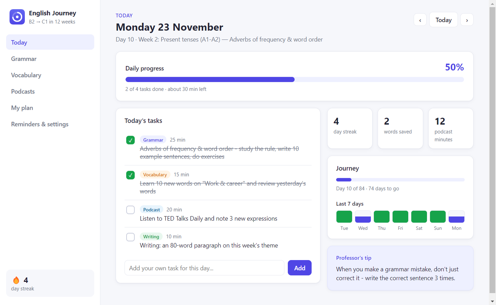
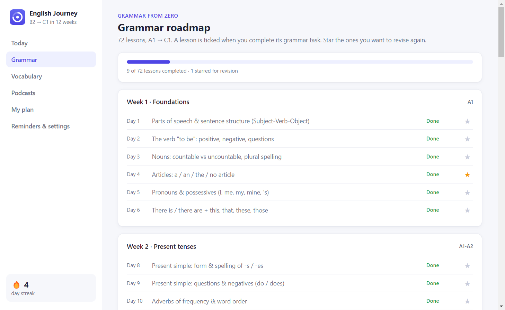
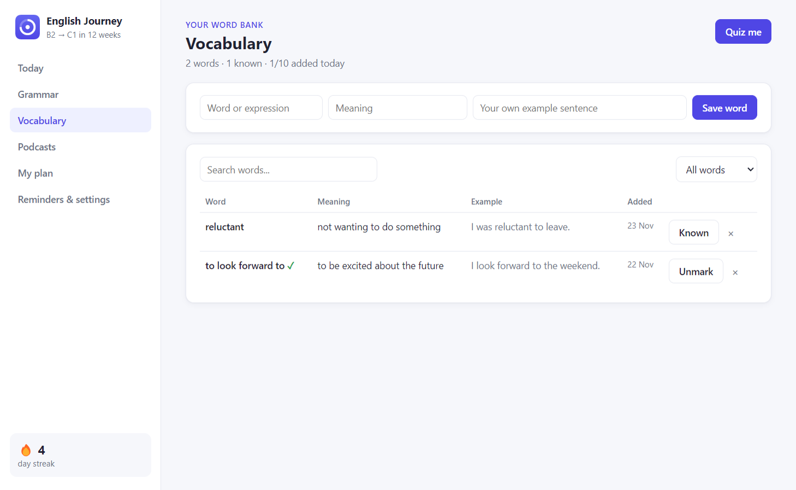
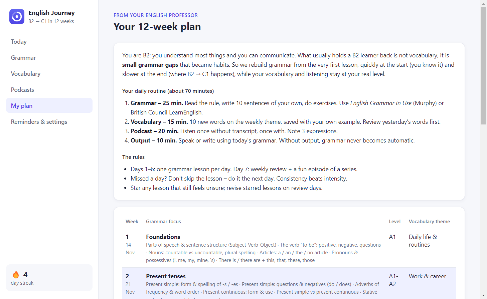

# English Journey — Project Report

**Project:** English Journey, a desktop tracker for learning English
**Author:** nour530
**Date:** 23 November 2026
**Version:** 1.0.0

---

## 1. Introduction

Learning a language well depends less on talent than on **consistency**: doing a little every day, in a balanced way, and seeing your progress. At B2 level a learner understands most things and can communicate, but progress often stops because of small grammar gaps that became habits, and because study is irregular and unplanned.

English Journey solves this with two things in one simple desktop app:

1. **A study plan** written like a teacher's programme: 12 weeks, one grammar lesson a day starting from the basics, plus daily vocabulary, listening and speaking/writing.
2. **A tracker** that turns that plan into a daily checklist with a progress bar, keeps a word bank and a podcast log, and reminds you to study.

## 2. Objectives

| # | Objective | How the app meets it |
|---|---|---|
| 1 | Revise all grammar from beginner level | 72 lessons, A1 → C1, one per day, tracked on the Grammar screen |
| 2 | Grow vocabulary | 10 words a day on a weekly theme, own example sentences, flashcard quiz |
| 3 | Improve listening | 20 min of podcast a day, episode log, recommended podcasts |
| 4 | Practise speaking and writing | A daily output task that uses the day's grammar |
| 5 | Stay consistent | Daily progress bar, streak, last-7-days view, Windows reminders |
| 6 | Keep it simple | One window, six screens, no account, no internet needed |

## 3. The learning plan (the teacher's part)

### 3.1 Starting point and approach

- **Level:** B2 (upper-intermediate).
- **Goal:** solid, automatic grammar and a move toward C1 in 12 weeks.
- **Approach:** "back to basics, fast". Weeks 1–3 cover A1–A2 grammar. You know most of it, so these days are quick, but they expose hidden errors (articles, third-person -s, irregular verbs, word order). The plan then slows down on B1–B2 topics, where B2 learners make most of their errors, and ends with C1 structures.
- Vocabulary and listening are **not** reset to beginner level: they stay at B2+ so you keep moving forward while grammar is rebuilt.

### 3.2 Daily routine (about 70 minutes)

| Block | Time | What to do |
|---|---|---|
| Grammar | 25 min | Read the rule (*English Grammar in Use* by Raymond Murphy, or British Council LearnEnglish), write **10 sentences about your own life**, do exercises. |
| Vocabulary | 15 min | Review yesterday's words first, then learn **10 new words** on the weekly theme and save them with your own example sentence. |
| Podcast | 20 min | Listen once without the transcript (general idea), then once with it (details). Note **3 new expressions**. |
| Output | 10 min | Speaking or writing using today's grammar (shadowing, recording yourself, a short paragraph or email). |

**Day 7 of every week** is review day: revise the 6 lessons (especially starred ones), self-test the week's words, listen to a podcast, and watch one episode of a series in English with English subtitles.

### 3.3 The 12-week programme

| Week | Grammar focus | Level | Vocabulary theme |
|---|---|---|---|
| 1 | **Foundations:** parts of speech & sentence structure, *to be*, countable/uncountable nouns, articles, pronouns & possessives, *there is/are* + demonstratives | A1 | Daily life & routines |
| 2 | **Present tenses:** present simple (form, questions, negatives), adverbs of frequency, present continuous, simple vs continuous, stative verbs | A1–A2 | Work & career |
| 3 | **The past:** past simple regular/irregular, questions & negatives, past continuous, *when/while*, *used to / would / be used to* | A2 | Travel & places |
| 4 | **Present perfect:** experiences, *just/already/yet*, *for/since*, present perfect vs past simple, present perfect continuous | B1 | Technology & the internet |
| 5 | **Narratives & future:** past perfect (simple & continuous), *will* vs *going to*, present forms for future, future continuous & perfect, time clauses | B1 | Health & lifestyle |
| 6 | **Modal verbs:** ability, permission, obligation (*mustn't* vs *don't have to*), advice, deduction, past modals | B1–B2 | Education & learning |
| 7 | **Conditionals:** zero, first, second, third, mixed; *unless / provided that / in case*; *wish / if only* | B1–B2 | Money & business |
| 8 | **The passive:** all tenses, modals, *by*-agent, *It is said that…*, causative *have/get something done* | B2 | Environment & nature |
| 9 | **Reported speech:** statements, questions, commands, reporting verbs, time/place changes | B2 | Media & news |
| 10 | **Clauses & verb patterns:** defining & non-defining relative clauses, gerund vs infinitive, participle clauses | B2 | Society & relationships |
| 11 | **The glue of English:** quantifiers, comparatives, prepositions, phrasal verbs, linking words, classic errors (*make/do, say/tell*) | B2 | Emotions & personality |
| 12 | **Advanced polish:** inversion, cleft sentences, emphasis, advanced articles, formal vs informal register, final mock test | B2–C1 | Academic words & idioms |

### 3.4 Recommended podcasts

| Podcast | Why |
|---|---|
| 6 Minute English (BBC) | Short, clear, with transcripts — the easiest daily habit |
| The English We Speak (BBC) | One idiom or expression in 3 minutes |
| All Ears English | Natural American conversation at B2+ |
| Luke's English Podcast | British teacher; long episodes build listening stamina |
| TED Talks Daily | Real native speed on interesting topics |

### 3.5 Teacher's rules

1. **Consistency beats intensity.** On a busy day do 10 minutes rather than nothing; the streak matters.
2. **Never skip a lesson.** If you miss a day, do that lesson the next day (use the ‹ › arrows on the Today screen).
3. **Make it personal.** Example sentences about your own life are remembered far better than textbook ones.
4. **Say it out loud.** Grammar you can say quickly is grammar you really own.
5. **Be honest with stars.** Star every lesson that still feels unsure and revise it on day 7.

### 3.6 Expected outcome after 12 weeks

- All core grammar revised once, with weak points identified (starred) and reviewed.
- About **720 new words** in your own word bank, with examples.
- About **28 hours** of listening.
- About **12 hours** of speaking and writing practice.

## 4. The application

### 4.1 Screens



**Today** — the four planned tasks for the day plus any tasks you add. Ticking a task moves the progress bar; at 100% the bar turns green. The side panel shows your streak, words saved, podcast minutes, journey progress (day X of 84), the last 7 days and a teacher tip.



**Grammar** — the 72 lessons grouped by week. Each lesson shows *Done*, *Today* or *Missed*, and can be starred for revision.



**Vocabulary** — a personal word bank with search, filter (all / still learning / known) and a *Quiz me* flashcard mode. Saving the 10th word of the day ticks the vocabulary task automatically.


**Podcasts** — log each episode with minutes and new expressions; see totals and the weekly goal (140 minutes). Logging an episode ticks the podcast task.



**My plan** — the programme above, with the current week highlighted.


**Reminders & settings** — three default reminders (08:00 grammar, 13:00 podcast, 21:00 progress check), add/pause/delete reminders, test notification, start date, start with Windows, export/import a backup file.

### 4.2 How the progress bar works

```
daily progress = tasks ticked today / total tasks today (planned + your own)
```

A day counts toward the **streak** only when it reaches 100%. Today not being finished yet does not break the streak until the day is over.

### 4.3 Technical design

| Part | Choice | Reason |
|---|---|---|
| Desktop shell | Electron 33 | Real Windows app (window, tray, notifications, start-up) with web-quality design |
| UI | Plain HTML, CSS, JavaScript | No framework = simple, fast, easy to modify |
| Storage | `localStorage` (one JSON object) | No database or server; data stays on your PC |
| Reminders | Web Notifications → Windows toast, checked every 20 s | Simple and reliable while the app runs (tray) |
| Packaging | electron-builder, portable `.exe` | One file, no installation |
| Security | `contextIsolation`, no Node in the page, CSP, all user text escaped | Safe defaults |

**Project structure**

```
english-journey-tracker/
├─ main.js            Window, tray icon, start-with-Windows, external links
├─ preload.js         Minimal bridge (start-up setting, show window)
├─ src/
│  ├─ index.html      Six screens
│  ├─ styles.css      Design system (colours, cards, bars, tables)
│  ├─ plan.js         12-week plan, podcasts, daily task generator
│  └─ app.js          State, rendering, events, reminders, backup
├─ scripts/make-icon.js   Draws the app icon (no dependencies)
├─ assets/icon.png
└─ docs/screenshots/
```

**Data model** (saved under the key `english-journey-v1`):

```js
{
  startDate: "2026-11-23",
  done:      { "2026-11-23": ["grammar", "vocab"] },
  custom:    { "2026-11-23": [{ id, text, done }] },
  words:     [{ id, word, meaning, example, date, known }],
  podcasts:  [{ id, show, episode, minutes, notes, date }],
  stars:     { "0-3": true },
  reminders: [{ id, time: "08:00", label, on }],
  fired:     { reminderId: "2026-11-23" }
}
```

### 4.4 Design

- Light, calm palette: off-white background, white cards, one indigo accent (`#4f46e5`), green for "done".
- Category colours on tasks (grammar indigo, vocabulary amber, podcast blue, speaking/writing green) so the day can be read at a glance.
- Windows system font (Segoe UI), generous spacing, one clear primary button per screen.

## 5. Testing

- The app was launched with demo data (journey started 9 days earlier, mixed completed days, words, a podcast, a starred lesson) and every screen was captured and checked — those are the screenshots in this report.
- Checked: progress percentage and "minutes left", streak calculation, last-7-days bars, grammar Done/Missed/Today status, vocabulary counts and filters, podcast totals, reminder list, settings.

## 6. How to use it

1. Install Node.js, then run `npm install` and `npm start` (or run the portable `.exe` from `dist/`).
2. Open **Reminders & settings**, set your start date (today by default) and tick *Start English Journey when Windows starts*.
3. Each day, open **Today** and work down the four tasks. Save words in **Vocabulary** and episodes in **Podcasts** — those tasks tick themselves.
4. On day 7, revise starred lessons and run *Quiz me*.
5. Export a backup now and then.

## 7. Limitations and future ideas

- Reminders only fire while the app is running (it stays in the tray after you close the window; enabling start-with-Windows covers this).
- Data is stored on one computer; use Export/Import to move it.
- Possible next steps: spaced-repetition scheduling for words, a weekly report chart, dark mode, built-in grammar exercises.

## 8. Conclusion

English Journey turns a professional study plan into small daily actions and makes progress visible. With about 70 minutes a day for 12 weeks, a B2 learner rebuilds grammar from the foundations, adds hundreds of personal words, and builds a stable listening and speaking habit — and the progress bar keeps the habit going.
